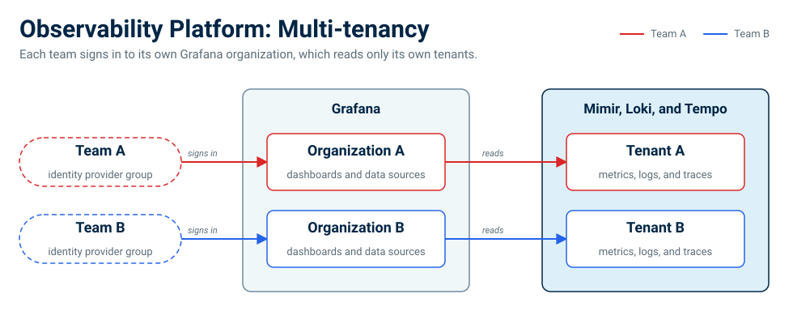
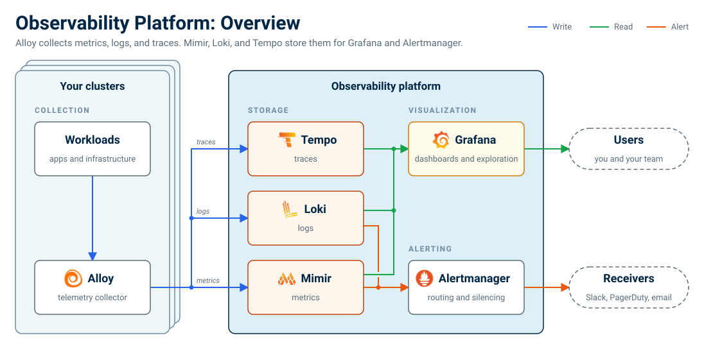
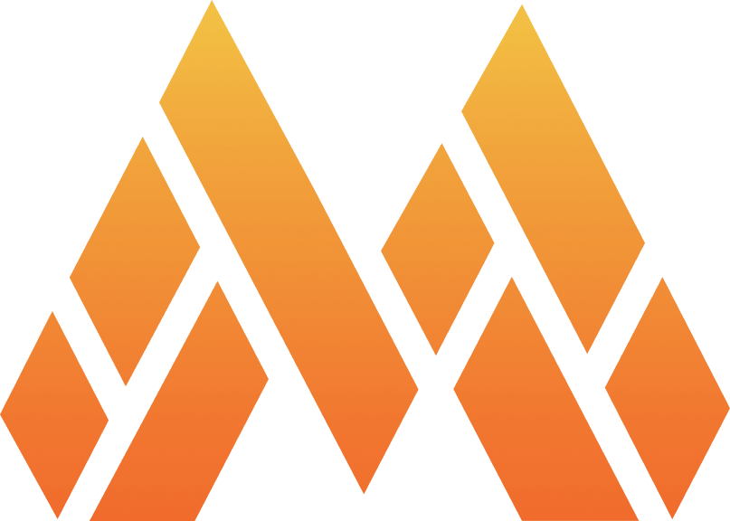
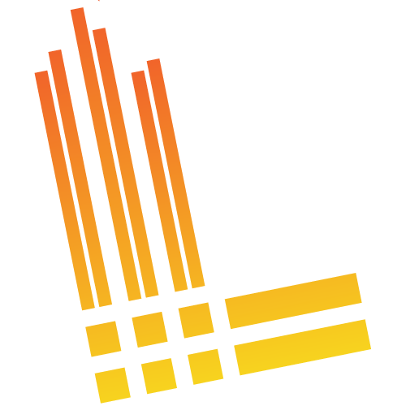
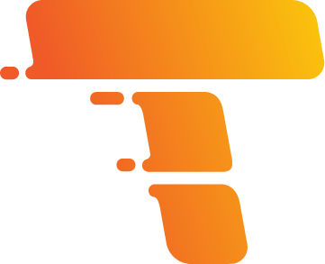
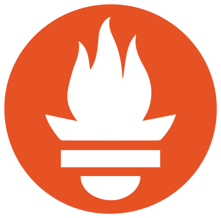
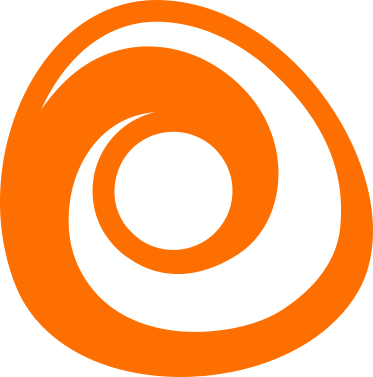

## What is observability

Observability is all about understanding what's happening in your systems, so you can keep things running smoothly, spot issues early, and make smart improvements. At Giant Swarm, we make observability a priority. Our platform gives you the tools to see what's going on in your clusters and applications, fix problems fast, and keep everything healthy. You'll get everything you need for data exploration, visualization, and alerting, all in a self-service way. Plus, we provide proven defaults to help you get started quickly and confidently.

## What you can do with observability

- <i class="fas fa-chart-line" aria-hidden="true"></i> **Monitor your systems:** Continuously collect and analyze metrics to check the performance and health of your applications and infrastructure. Effective monitoring helps you spot anomalies, understand usage patterns, and make data-driven decisions.

- <i class="fas fa-file-alt" aria-hidden="true"></i> **Centralize your logs:** Capture detailed records of system and application events. Centralized logging makes troubleshooting and auditing easier. Search and analyze logs to find issues, track changes, and meet compliance needs, all in one place.

- <i class="fas fa-stream" aria-hidden="true"></i> **Trace your requests:** Follow requests as they flow through your distributed systems. Distributed tracing helps you understand how services interact, identify bottlenecks, and troubleshoot performance issues across your entire application stack. Tracing isn't enabled by default, so ask your account engineer to enable it for your installation. Once it's on, [send your traces with OpenTelemetry]().

- <i class="fas fa-chart-bar" aria-hidden="true"></i> **Visualize your data:** Connect the dots between different data sources. Use dashboards, visualizations, and alerts to get a clear picture of your platform. Start with our ready-made dashboards or create your own to track what matters most to you.

- <i class="fas fa-bell" aria-hidden="true"></i> **Get notified with alerts:** Don’t spend your day staring at dashboards. Set up alerting rules to get notified about important events or issues that need your attention. Our alerting features help your team avoid repetitive checks and focus on what matters.

- <i class="fas fa-user-shield" aria-hidden="true"></i> **Work securely with multi-tenancy:** Keep sensitive data safe by isolating it for the right teams, departments, or organizational structures. Our multi-tenant solution ensures only the right people have access to the right data.

Each team signs in to its own Grafana organization, and each organization reads only the tenants assigned to it:

One of the biggest benefits of using Giant Swarm is that you get the same reliable, integrated observability tools our own teams use every day. This gives you a comprehensive view of your applications and infrastructure, right out of the box.

## The technology behind our platform

We rely exclusively on open source tools, so you have complete ownership of the software that we run for you.
Alloy collects metrics, logs, and traces from your workloads and sends them to Mimir, Loki, and Tempo. You explore all three in Grafana, and Alertmanager notifies you when an alerting rule fires:

Here are the most important tools we rely on:

-  **Mimir:** An open-source, horizontally scalable, highly available, multi-tenant time series database for long-term metric storage. Mimir is at the core of our metrics system. It stores the metrics that Alloy collects as time series data, and enables powerful querying and alerting.

-  **Loki:** An open-source, horizontally scalable, highly available log aggregation system. Loki stores the logs that Alloy collects, in any format, covering everything from app logs and Kubernetes events to audit logs. With LogQL, you can query logs and even generate metrics from log data.

-  **Tempo:** An open-source, horizontally scalable distributed tracing backend. Tempo ingests traces from any source, stores them efficiently, and provides fast querying capabilities. It integrates with OpenTelemetry and supports TraceQL for powerful trace analysis and service graph visualization.

-  **Grafana:** A popular open-source visualization tool for exploring metrics, logs, and traces. Grafana lets you create dashboards and graphs for all your observability needs. It integrates seamlessly with Mimir, Loki, and Tempo, and supports other data sources like Prometheus, Elasticsearch, and InfluxDB.

-  **Alertmanager:** We run the Mimir Alertmanager, which builds on the Prometheus Alertmanager and handles all your alerts. It manages routing, grouping, and silencing, so the right people get notified at the right time. It supports notifications via email, Slack, PagerDuty, and more.

-  **Alloy:** As an OpenTelemetry collector, Grafana Alloy makes it easy to collect, process, and forward metrics, logs, and traces from your workloads. Adding new data is as simple as setting up a new service monitor or adding the right labels.

---

## Alert management

Stay informed about your system's health with powerful [alert management capabilities](). Create custom alerting rules, configure intelligent routing, and manage alert silences to ensure your team gets notified about the right issues at the right time.

## Dashboard management

Create and organize custom visualizations with our [dashboard management capabilities](). Whether you prefer GitOps workflows or interactive creation, the platform provides flexible approaches to build dashboards that meet your specific monitoring needs while supporting multi-tenant organization.

## Data management

The observability platform provides comprehensive [data management capabilities]() that handle the complete lifecycle of your observability data - from collection and storage to analysis and export. Our integrated approach ensures efficient data flow while maintaining security, performance, and multi-tenancy across all data types including metrics, logs, and traces.

Learn how to start with observability on Giant Swarm by visiting our [getting started observability page]().
